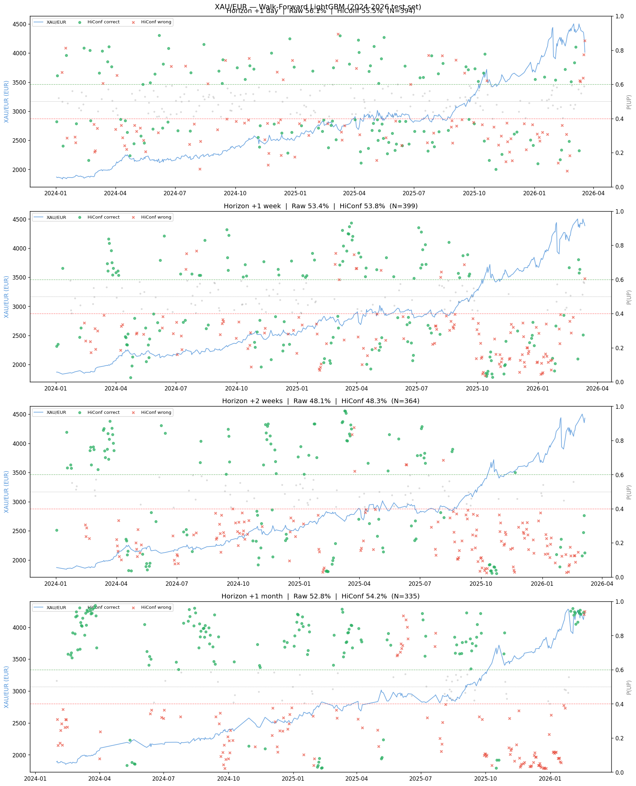
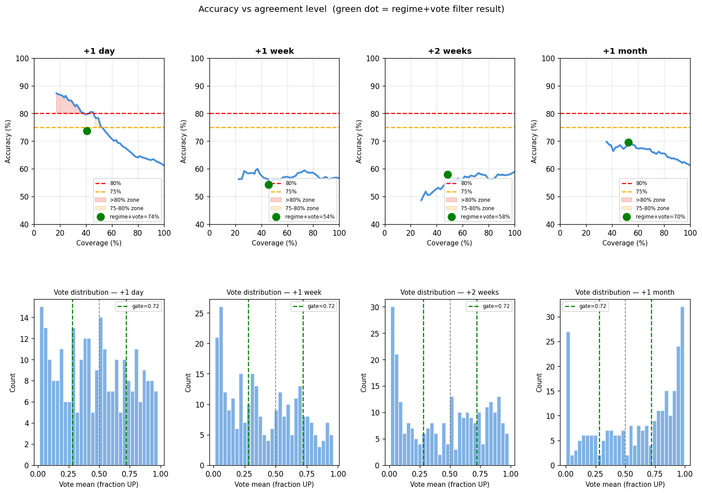
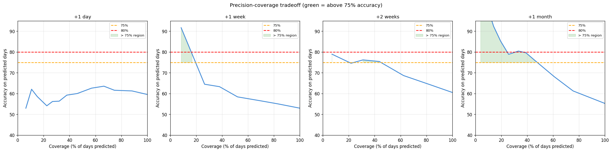
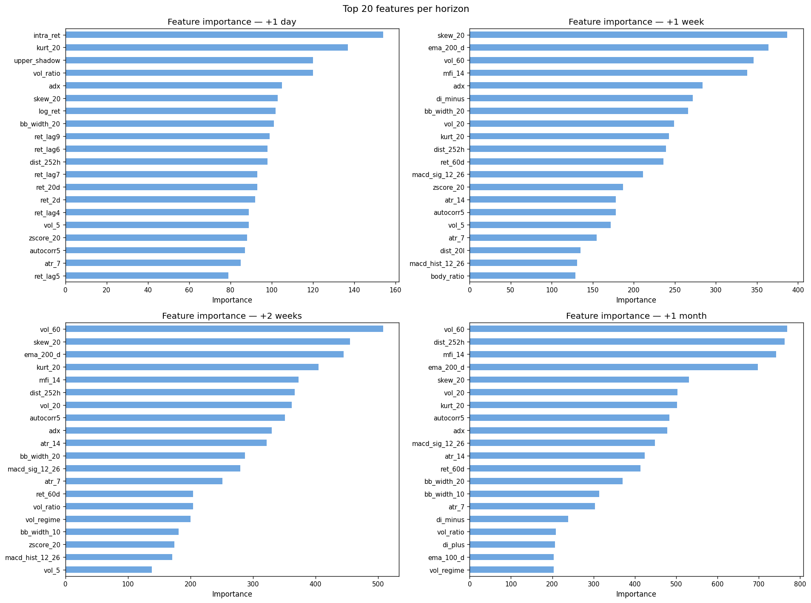
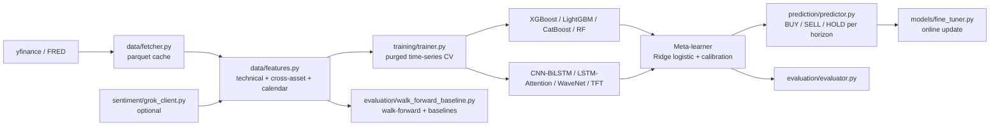

<p align="center">
  
</p>

<p align="center">
  
</p>

<p align="center">
  
  
  
  
  
  
</p>

<p align="center">
  
  <br/><em>Real output of the walk-forward LightGBM run on the 2024-2026 test period. Green/red markers are high-confidence calls that were right/wrong.</em>
</p>

## Table of contents

- [Overview](#-overview)
- [Features](#-features)
- [Evaluation](#-evaluation)
- [Screenshots](#-screenshots)
- [Architecture](#-architecture)
- [Tech stack](#-tech-stack)
- [Requirements](#-requirements)
- [Installation and configuration](#-installation-and-configuration)
- [Usage](#-usage)
- [Project structure](#-project-structure)
- [Testing and verification](#-testing-and-verification)
- [Troubleshooting / FAQ](#-troubleshooting--faq)
- [Known limitations and next steps](#-known-limitations-and-next-steps)
- [Roadmap](#-roadmap)
- [Contributing](#-contributing)
- [License](#-license)
- [Author](#-author)

## 🎯 Overview

**Problem.** Daily and weekly gold moves are noisy, and most "gold predictor" projects overstate their accuracy because of look-ahead leakage, overlapping labels and no baseline to compare against.

**Solution.** This repository is an end-to-end applied-ML pipeline for the direction of gold priced in euros (XAU/EUR) at four horizons (+1 day, +1 week, +2 weeks, +1 month). It focuses on the engineering that makes a result trustworthy: free-data ingestion with a committed cache, a 135-column feature set, 8 diverse base models behind one interface, a two-layer stacking ensemble with purged time-series cross-validation and probability calibration, and a walk-forward evaluation that is always reported next to simple baselines.

> This is a research and education project, not a trading system. Not financial advice.

## ✨ Features

- **Data layer** on free sources (yfinance, FRED through pandas-datareader), cached as parquet. The cached XAU/EUR data (2012 to 2026-03-20) is committed, so you can start without downloading anything.
- **135-column feature set**: technicals (RSI, MACD, Bollinger, ATR, ADX, MFI, skew/kurtosis, EMA distances), cross-asset ratios and rolling correlations (silver, oil, copper, platinum, S&P 500, VIX, DXY, yields, TLT, USD/JPY), calendar features.
- **8 base models** behind a common interface: XGBoost, LightGBM, CatBoost, Random Forest, CNN-BiLSTM, LSTM-Attention, WaveNet-style dilated CNN, Temporal Fusion Transformer (PyTorch).
- **Two-layer stacking**: purged time-series CV (gap between train and test folds), Ridge logistic meta-learner, isotonic/Platt calibration, threshold search on out-of-fold predictions.
- **BUY / SELL / HOLD** output with probabilities at each horizon.
- **Online fine-tuning** of the tree models and the meta-learner on recent data.
- **Optional sentiment feature** through the xAI Grok API (disabled by default).
- **Evaluation tooling**: accuracy, Sharpe-style stats, confusion matrices, precision-vs-coverage curves, and a stand-alone walk-forward script with baselines and significance tests.

## 📊 Evaluation

Predicting gold direction is hard, and the figures below are reported with their context (split type, baseline) rather than on their own.

**Walk-forward LightGBM, test period 2024-2026 (from the notebook behind the plot above):**

| Horizon | Accuracy | Chance level |
|---|---|---|
| +1 day | 56.1% | 50% |
| +1 week | 53.4% | 50% |
| +2 weeks | 48.1% | 50% |
| +1 month | 52.8% | 50% |

**Confidence-filtered ensemble (diversity notebook v1).** A regime and model-agreement filter raised accuracy on the days it chose to predict, for example +1 month: 61.3% on all days versus 69.5% on 52% of days. The filtered subsets are small, so treat these as indicative, not as an edge. The later v3 notebook (adaptive labels + stacking, much stricter gate) emits very few signals on the test period, so its headline accuracies are not statistically meaningful.

**Baseline-aware re-evaluation (new, reproducible: [`evaluation/walk_forward_baseline.py`](evaluation/walk_forward_baseline.py)).** Expanding window, retrained every 63 days, labels recomputed from the price series, purge gap equal to the horizon, test from 2024-01-01 (LightGBM, `python evaluation/walk_forward_baseline.py`). Real numbers from running it:

| Target series | Horizon | n test | Accuracy | Always-UP baseline | AUC | p-value vs 50% |
|---|---|---|---|---|---|---|
| XAU_USD | +1 day | 579 | 52.8% | 56.3% | 0.536 | 0.18 |
| XAU_USD | +1 week | 575 | 52.7% | 64.5% | 0.570 | 0.21 |
| XAU_USD | +2 weeks | 570 | 55.8% | 66.5% | 0.619 | 0.006 |
| XAU_USD | +1 month | 558 | 56.6% | 78.3% | 0.539 | 0.002 |
| XAU_EUR | +1 day | 579 | 60.3% | 55.1% | 0.626 | <0.001 |
| XAU_EUR | +1 week | 575 | 56.7% | 63.8% | 0.624 | 0.0015 |
| XAU_EUR | +2 weeks | 570 | 60.7% | 67.9% | 0.642 | <0.001 |
| XAU_EUR | +1 month | 558 | 57.9% | 79.9% | 0.556 | <0.001 |

How to read this:

- Gold trended up strongly in 2024-2026, so "always predict UP" scores 55% to 80% depending on horizon. At every horizon except +1 day (XAU_EUR) the model's accuracy is **below** that baseline, so these models do not beat a trivial buy-and-hold call in this period. AUC around 0.54 to 0.64 shows some ranking information, but it is modest.
- The XAU_EUR +1 day row (60.3%, AUC 0.63) is the interesting one, and the script helped explain it: in the cached data, EUR/USD returns on day t+1 correlate about 0.28 with gold-in-USD returns on day t, because the two yfinance series are not timestamp-aligned. The constructed XAU_EUR series therefore has a lag-1 autocorrelation of about -0.15 that neither component has (about -0.03 each). Models can learn that artefact, which is why XAU_USD (no such artefact) falls back to 52.8%. Treat the XAU_EUR +1 day result as a data-alignment effect, not as a tradable signal.

## 🖼 Screenshots

| Accuracy vs agreement level | Precision vs coverage |
|---|---|
|  |  |



## 🏗 Architecture



## 🧰 Tech stack

| Area | Tools |
|---|---|
| Language | Python 3.12 |
| Gradient boosting | XGBoost, LightGBM, CatBoost |
| Deep learning | PyTorch (CNN-BiLSTM, LSTM-Attention, WaveNet-style CNN, TFT) |
| ML utilities | scikit-learn (meta-learner, calibration), scipy, statsmodels, shap |
| Data | pandas, pyarrow (parquet), yfinance, pandas-datareader, ta |
| Visualization | matplotlib, seaborn, plotly, Jupyter |
| Optional | xAI Grok API through the `openai` SDK |

## 📋 Requirements

| Item | Requirement |
|---|---|
| OS | Windows 10/11 (the requirements file says "tested" there); Linux/macOS should work but were not tested |
| Python | 3.12 (the version this was built and run with) |
| Hardware | CPU is enough for the data step and the walk-forward script. An NVIDIA GPU (CUDA 12.1 build of PyTorch) is recommended for training the deep models |
| Disk | About 4 MB for the committed data cache; trained models are not included and can take hundreds of MB |
| Network | Needed only to refresh data (Yahoo Finance and FRED, no keys required). The committed cache works offline |
| Accounts / keys | None required. Only the optional sentiment feature needs an xAI API key (`GROK_API_KEY`, from https://console.x.ai) |
| Ports | None |

## ⚙️ Installation and configuration

```bash
git clone https://github.com/ORD1STAR/xau-price-predictor.git
cd xau-price-predictor

python -m venv .venv
# Windows: .venv\Scripts\activate      Linux/macOS: source .venv/bin/activate

pip install -r requirements.txt

# Optional: CUDA build of PyTorch (NVIDIA GPU)
pip install torch torchvision --index-url https://download.pytorch.org/whl/cu121
```

`requirements.txt` pins `numpy>=1.26,<2.0`. The walk-forward script only needs numpy, pandas, scipy, scikit-learn, lightgbm and pyarrow.

**Environment variables** (all optional):

| Name | Required | Description | Example placeholder |
|---|---|---|---|
| `GROK_API_KEY` | No | xAI API key, only used when `GROK_ENABLED = True` in `config.py` | `YOUR_XAI_API_KEY` |

`config.py` reads `GROK_API_KEY` with `os.getenv`; it does not load `.env` by itself, so export the variable in your shell (for example `export GROK_API_KEY=YOUR_XAI_API_KEY`) and set `GROK_ENABLED = True`. `.env.example` is provided as a template.

Other settings (date ranges, tickers, hyperparameters, CV protocol, thresholds) live in `config.py`.

## 🚀 Usage

```bash
python main.py --mode data       # fetch / load cached data and build features
python main.py --mode train      # train on 2012-2022 (purged time-series CV)
python main.py --mode evaluate   # evaluate on 2023-2026
python main.py --mode predict    # BUY/SELL/HOLD for the latest day (fetches fresh data)
python main.py --mode finetune   # incremental update (add --dl for deep models)
python main.py --mode full       # data -> train -> evaluate -> predict
python main.py --mode clear      # delete saved models and feature cache before retraining

# Baseline-aware walk-forward evaluation (needs data/cache/features.parquet, which is committed)
python evaluation/walk_forward_baseline.py --price-col XAU_EUR
python evaluation/walk_forward_baseline.py --price-col XAU_USD --test-start 2024-01-01
```

The `main.py` modes mirror its CLI; the full train mode was not re-run when preparing this repository for publication. The walk-forward script was run and its numbers are in the Evaluation section.

## 🗂 Project structure

<details>
<summary>Show tree</summary>

```
main.py                 CLI entry point (data / train / evaluate / predict / finetune / clear)
config.py               tickers, hyperparameters, CV protocol, thresholds
data/                   fetcher, feature engineering, cached parquet (data/cache)
models/                 base models, stacking ensemble, fine-tuner
training/               trainer with purged CV
evaluation/             evaluator.py, walk_forward_baseline.py
prediction/             predictor (BUY / SELL / HOLD)
sentiment/              optional Grok client + manual event injector
utils/                  verify_setup.py
notebooks/              pipeline walkthrough, diversity ensemble (v1), adaptive stacking (v3)
docs/                   plots exported from the notebooks
```

</details>

## 🧪 Testing and verification

There is no unit-test suite. Verification is done through:

- `python utils/verify_setup.py`: environment sanity check (note: its package list still mentions TensorFlow, which the project no longer uses).
- `python evaluation/walk_forward_baseline.py`: leakage-free walk-forward run with baselines and a binomial test; writes `results/walk_forward_baseline_<series>.csv` (git-ignored).
- The notebooks in `notebooks/` contain the executed experiments behind the plots.

## 🩺 Troubleshooting / FAQ

<details>
<summary>Feature-count mismatch (for example 103 vs 107) when loading saved models</summary>

Saved models trained on an older feature set will not match the current features. Run `python main.py --mode clear`, then `python main.py --mode train`.
</details>

<details>
<summary>Why are there no trained models in the repo?</summary>

They were hundreds of MB, so they are excluded. Run `--mode train` to create them under `models/saved/`.
</details>

<details>
<summary>The data step fails or returns empty columns</summary>

The data comes from Yahoo Finance and FRED, which can rate-limit or change tickers. Use the committed cache (`--mode data` without `--no-cache`) or retry later.
</details>

<details>
<summary>Why does XAU_EUR +1 day look better than XAU_USD?</summary>

See the Evaluation section: a one-day timestamp misalignment between the gold and EUR/USD series creates a predictable artefact in the constructed XAU/EUR series.
</details>

## 🔭 Known limitations and next steps

- Accuracy is close to chance and below the always-UP baseline on the 2024-2026 test period (see Evaluation). The pipeline is the contribution; no profitable signal is claimed.
- **Fix the data alignment**: align EUR/USD and gold to the same daily timestamp (or build XAU/EUR from one consistent source) and re-run the walk-forward script; expect the XAU_EUR +1 day advantage to shrink toward the XAU_USD numbers.
- `data/features.py` encodes the tail rows without a full forward window as label 0 (`(fwd > 0)` on NaN); drop those rows when training or evaluating.
- Evaluate against the always-UP baseline and with a class-balanced or return-weighted metric, since gold drifted upward in the test window.
- Add transaction-cost-aware backtesting and significance tests for the confidence-filtered signals.
- Notebook experiments are exploratory and not yet refactored into the package.

## 🗺 Roadmap

- [x] Data layer with parquet cache
- [x] 135-feature engineering pipeline
- [x] 8 base models + stacking ensemble with purged CV
- [x] Walk-forward evaluation with baselines and binomial test
- [ ] Fix the XAU/EUR timestamp alignment and re-evaluate
- [ ] Drop incomplete-horizon tail rows from labels
- [ ] Transaction-cost-aware backtest
- [ ] Unit tests for feature leakage (no feature uses future rows)
- [ ] Refactor the notebook experiments into the package

## 🤝 Contributing

Issues and pull requests are welcome. For larger changes, open an issue first. Please keep evaluation leakage-free and report results next to a baseline.

## 📄 License

MIT. See [LICENSE](LICENSE).

## 👤 Author

<table>
  <tr>
    <td><b>Hannoun Amine Amar</b><br/>Algeria<br/>
      <a href="https://www.linkedin.com/in/hannoun-amine/">LinkedIn</a> |
      <a href="https://github.com/ORD1STAR">GitHub</a> |
      <a href="mailto:hannoun.amine25@gmail.com">hannoun.amine25@gmail.com</a>
    </td>
  </tr>
</table>

Disclaimer: for research and education only. Not financial advice.

<p align="center">
  
</p>
