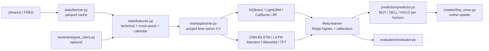

# XAU Price Predictor

Directional forecasting of gold priced in euros (XAU/EUR) at four horizons, using a stacking ensemble of gradient-boosted trees and PyTorch sequence models, with purged time-series cross-validation and honest walk-forward evaluation.


> Real output from the walk-forward LightGBM run on the 2024-2026 test period. Green/red markers are high-confidence calls that turned out right/wrong.

## Honest summary

This is an applied-ML research project, not a trading system. Predicting gold direction is hard, and the results here reflect that:

- Walk-forward LightGBM accuracy on 2024-2026 (plot above): **56.1%** (+1 day), **53.4%** (+1 week), **48.1%** (+2 weeks), **52.8%** (+1 month), i.e. close to chance.
- In the first diversity-ensemble notebook, a regime + agreement filter raised accuracy on the days it chose to predict (for example +1 month: 61.3% on all days vs 69.5% on 52% of days). Filtered subsets are small, so treat these numbers as indicative, not as an edge.
- The later v3 notebook (adaptive labels + stacking, with a much stricter gate) emits very few signals on the test period, so its headline accuracies are not statistically meaningful.

The value of the repo is the pipeline design (leakage-aware CV, calibration, multi-horizon stacking, diagnostics), not a profitable signal.

## Features

- Data layer pulling free sources (yfinance, FRED via pandas-datareader), cached as parquet. Cached XAU/EUR data (2012 to 2026-03-20) is committed so you can start without downloading.
- 135-column engineered feature set: technicals (RSI, MACD, Bollinger, ATR, ADX, MFI, skew/kurtosis, EMA distances), cross-asset ratios and rolling correlations (silver, oil, copper, platinum, S&P 500, VIX, DXY, yields, TLT, USD/JPY), calendar features.
- 8 base models behind a common interface: XGBoost, LightGBM, CatBoost, Random Forest, CNN-BiLSTM, LSTM-Attention, WaveNet-style dilated CNN, Temporal Fusion Transformer (PyTorch).
- Two-layer stacking ensemble: purged time-series CV (gap between train and test folds), Ridge logistic-regression meta-learner, isotonic/Platt calibration, threshold search on out-of-fold predictions.
- Horizons: next day, week, 2 weeks, month. BUY / SELL / HOLD output with probabilities.
- Online fine-tuning of tree models and meta-learner on recent data.
- Optional news/sentiment feature through the xAI Grok API (disabled by default).
- Evaluation: accuracy, Sharpe-style stats, confusion matrices, precision vs coverage curves.

## Architecture



## Tech stack

Python 3.12, PyTorch, XGBoost, LightGBM, CatBoost, scikit-learn, pandas, pyarrow, yfinance, pandas-datareader, ta, matplotlib/seaborn/plotly, Jupyter.

## Getting started

```bash
pip install -r requirements.txt
# optional GPU build of torch: see header of requirements.txt

python main.py --mode data       # fetch / load cached data and build features
python main.py --mode train      # train on 2012-2022
python main.py --mode evaluate   # evaluate on 2023-2026
python main.py --mode predict    # signal for the latest day
python main.py --mode finetune   # incremental update
python main.py --mode full       # all steps
```

Optional sentiment: copy `.env.example` to `.env`, set `GROK_API_KEY`, and set `GROK_ENABLED = True` in `config.py`.

Note: trained model files are not included (they were hundreds of MB), so run the `train` mode first. The commands above mirror the CLI defined in `main.py`; they were not re-run when preparing this repository for publication.

## Screenshots

| Accuracy vs agreement level | Precision vs coverage |
|---|---|
|  |  |


## Project structure

```
main.py                 CLI entry point (data / train / evaluate / predict / finetune)
config.py               tickers, hyperparameters, CV protocol, thresholds
data/                   fetcher, feature engineering, cached parquet
models/                 base models, stacking ensemble, fine-tuner
training/  evaluation/  prediction/  sentiment/  utils/
notebooks/              pipeline walkthrough, diversity ensemble (v1), adaptive stacking (v3)
docs/                   plots exported from the notebooks
```

## Roadmap / notes

- Saved models trained on an older feature set raised a feature-count mismatch (103 vs 107) in the original logs; retrain after any feature change (`--mode clear`, then `--mode train`).
- Add transaction-cost-aware backtesting and proper significance tests for the filtered signals.
- Notebook experiments are exploratory and not refactored into the package.

## Author

Hannoun Amine Amar, Algeria. [LinkedIn](https://www.linkedin.com/in/hannoun-amine/), hannoun.amine25@gmail.com

Disclaimer: for research and education only. Not financial advice.
